# Behavior tree inventory and graphs

Inspected 2026-10-15. Source registrations plus the installed BehaviorTree.CPP 4.10.0 factory manifest. No flight processes were started. Phase 2 update: the rebuilt installed runner now exports the registry, confirming the category totals below.

## Registered node types

| Category | AERIXIS custom | Library built-ins | Combined |
|---|---:|---:|---:|
| Action | 13 | 7 | 20 |
| Condition | 2 | 1 | 3 |
| Decorator | 2 | 16 | 18 |
| Control | 0 | 17 | 17 |
| SubTree | 0 | 1 | 1 |

SubTree is listed separately. Node *types* differ from node *instances* in a mission. Model declarations inside TreeNodesModel do not register executable implementations.

### AERIXIS registrations

- **Action:** `Arm`, `Disarm`, `Offboard`, `TakeOff`, `GoTo`, `Land`, `SendEvent`, `Echo`, `SetOrigin`, `GetOrigin`, `GpsToCartesian`, `GoToGps`, `FollowPath`
- **Condition:** `IsFlying`, `IsPersonDetected`
- **Decorator:** `WaitForEvent`, `WaitForAlert`

### Library registrations

- **Action:** `AlwaysFailure`, `AlwaysSuccess`, `Script`, `SetBlackboard`, `Sleep`, `UnsetBlackboard`, `WasEntryUpdated`
- **Condition:** `ScriptCondition`
- **Decorator:** `Delay`, `ForceFailure`, `ForceSuccess`, `Inverter`, `KeepRunningUntilFailure`, `LoopBool`, `LoopDouble`, `LoopInt`, `LoopString`, `Precondition`, `Repeat`, `RetryUntilSuccessful`, `RunOnce`, `SkipUnlessUpdated`, `Timeout`, `WaitValueUpdate`
- **Control:** `AsyncFallback`, `AsyncSequence`, `Fallback`, `IfThenElse`, `Parallel`, `ParallelAll`, `ReactiveFallback`, `ReactiveSequence`, `Sequence`, `SequenceWithMemory`, `Switch2`, `Switch3`, `Switch4`, `Switch5`, `Switch6`, `TryCatch`, `WhileDoElse`
- **SubTree:** `SubTree`

## Checked-in XML trees

These are structural graphs, not flight validation. Graphs include every BehaviorTree definition in as2_behavior_tree/resource. SubTree calls are shown as call nodes; definitions are graphed separately. Legacy XML and missing ports can still prevent execution. UNKNOWN marks IDs absent from the inspected factory plus AERIXIS registrations.

### RTL_test_2.xml

Tree `BehaviorTree`

Action: 11, Control: 3, Decorator: 1.

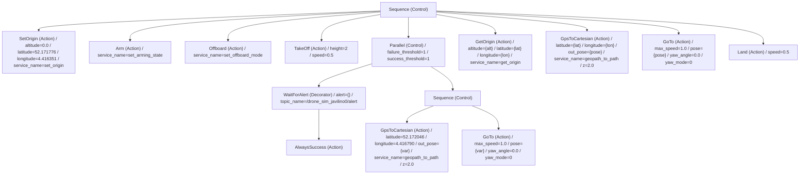

### actions.xml

Node-model metadata only; no executable BehaviorTree definition.

### arm_test.xml

Tree `BehaviorTree`

Action: 1.

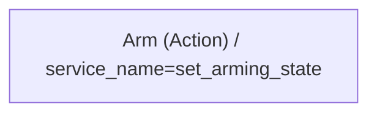

### as2_mission_tree.xml

Tree `MainTree`

Action: 9, Control: 1.

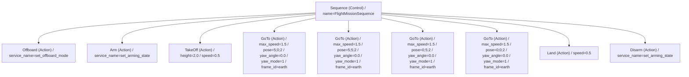

### basic_mission.xml

Tree `BehaviorTree`

Action: 6, Control: 1.

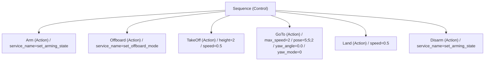

### event_test.xml

Tree `BehaviorTree`

Action: 2, Control: 1, Decorator: 3.

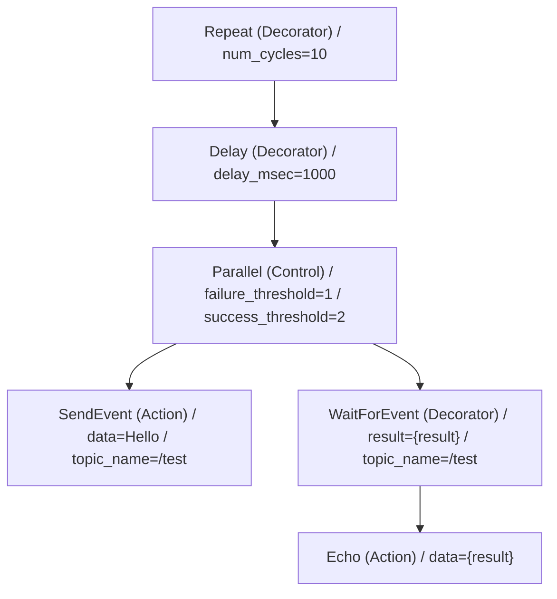

### event_test_2.xml

Tree `BehaviorTree`

Action: 8, Control: 4, Decorator: 8, UNKNOWN: 1.

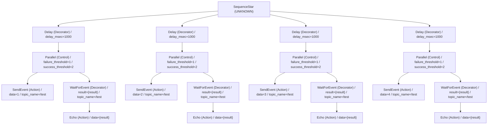

### follow_path_test.xml

Tree `ArmTakeoff`

Action: 3, UNKNOWN: 1.

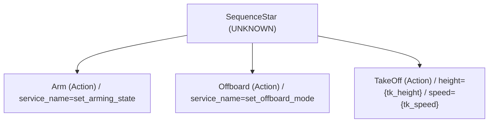

Tree `BehaviorTree`

Action: 2, Control: 1, Decorator: 1.

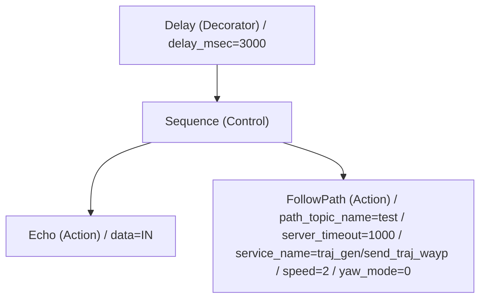

Tree `RTL`

Action: 3, UNKNOWN: 1.

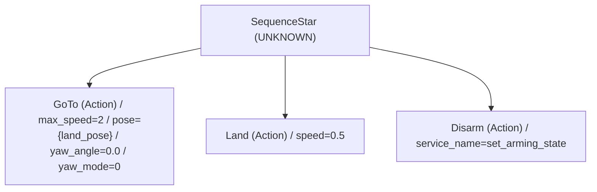

### takeoff.xml

Tree `ArmTakeoff`

Action: 3, UNKNOWN: 1.

Tree `BehaviorTree`

Condition: 1, Control: 1, Decorator: 1, SubTree: 1.

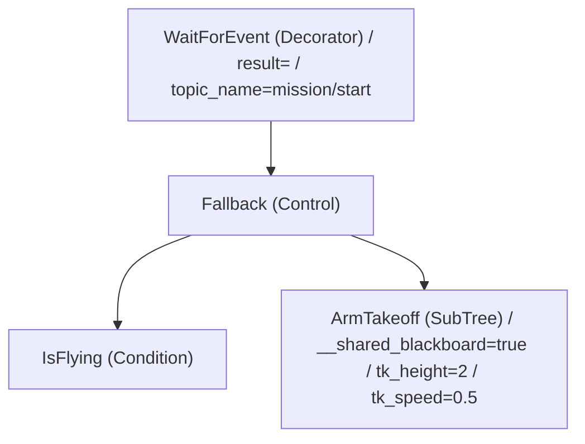

### test.xml

Tree `BehaviorTree`

Action: 3, Control: 1.

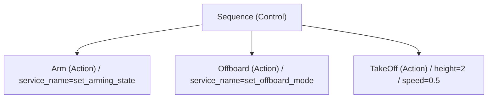

### person_detection_check.xml (new observation-only bench tree)

Tree `PersonObservation`: 3 decorators, 1 condition. No flight/payload actions.

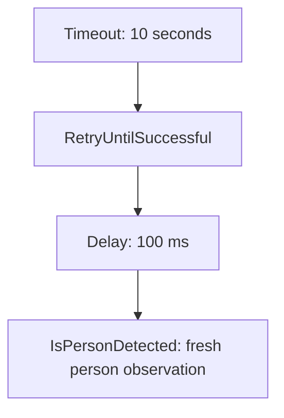

## Current GCS-generated survey tree

Source: /home/prince/custom_gcs/web/js/bt_studio.js generateBtXml(). For N GoTo survey waypoints: N + 5 action instances, 2 control instances, 0 condition instances, 0 decorator instances. The root and BehaviorTree XML wrappers are not executable nodes.

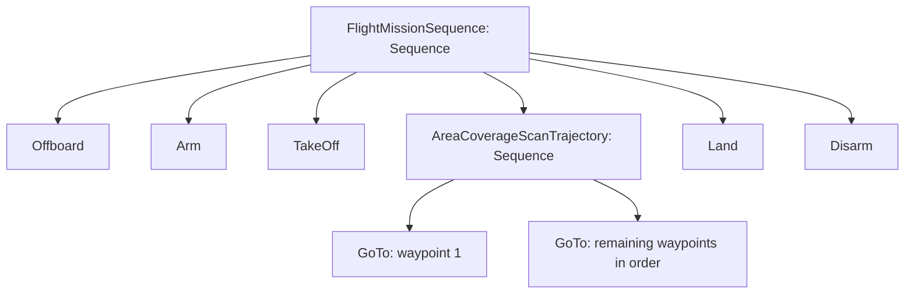

This does not count a live uploaded /tmp mission: its contents and execution state were not inspected. The checked-in as2_mission_tree.xml has 9 action instances and 1 Sequence, without the GCS coverage grouping.

## Integration gaps found

- Fixed in the Phase 2 UI update: the GCS dwell item now exports `Sleep msec="..."`, converting seconds to milliseconds. `Wait` is not a registered tag.
- GCS emits FollowPath without the required mission data. Its wrapper expects path, frame_id, speed and yaw_mode.
- actions.xml advertises IsTargetDetected, IsArucoDetected and UnPick, which are not registered by this engine.
- FollowReference implementation is compiled, but not registered in the engine.
- SwarmFlocking, PointGimbal and gripper behaviors exist elsewhere; their presence does not make them available as BT XML nodes.
- IsPersonDetected is now registered as an observation-only condition. Mesh-health, battery, payload-loaded and release nodes remain unimplemented. The default survey mission does not automatically include detection.
