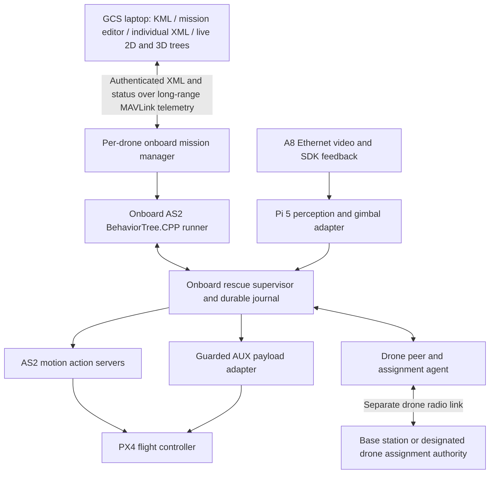

# Rescue runtime and GCS implementation — 2026-10-16

This is an implemented development/bench integration, not a flight-qualified release. The onboard C++ BT runner, Python rescue services and laptop GCS are separate processes. The master handoff is historical context: its mesh, collision avoidance and production-readiness descriptions are not proof that those capabilities exist or have been tested.

## Where decisions run



Each aircraft executes its own uploaded XML using its onboard registered nodes. Closing the laptop does not transfer its decision-making offboard or automatically stop flight. Radio/position/vehicle faults are evaluated onboard; PX4 must also have independently tested failsafe behavior. The separate swarm radio does not need to attach to the GCS. Its reported peer/assignment health travels through each drone's normal GCS telemetry connection.

AERIXIS does not configure a LoRa mesh automatically. `mesh_bridge` transports authenticated application messages over an explicitly configured transparent UART modem. Radio addressing/routing, frequency, airtime and topology remain hardware configuration. Raw SPI LoRa boards need a hardware driver before they can use this bridge. There is no claim of a verified 20–30 km range.

## Implemented software

- 96 registered node types: **38 Actions, 18 Conditions, 21 Decorators, 18 Controls, 1 SubTree type**. These are types; running-node counts are instances reported separately for each aircraft. See [every node's purpose and safety use](BT_NODE_GUIDE.md).
- 37 new rescue registrations: 18 actions, 15 conditions, 3 decorators and 1 control. Standard AERIXIS and BehaviorTree.CPP registrations remain available; scripts, dynamic blackboard wiring and typed FollowPath uploads are restricted by the current upload validator.
- Seven editable templates: waypoints, surveillance, search/geotag, rescue delivery, planned-waypoint delivery, swarm search and swarm delivery. [XML files](../integrations/gcs/templates/) are generated from the same definitions as the GCS catalog.
- A8 UDP SDK packet codec, measured attitude queries, bounded image-centering commands, stale-frame stop and oscillation latch. Commands remain disabled until calibrated.
- Calibrated optical-ray geolocation with timestamped camera TF, measured surface, location uncertainty and optional verified geographic origin. Gimbal angles alone do not establish a geotag.
- Persistent coverage checkpoints, action cancellation and goal-termination handover, measured hold, approach to an approved delivery zone, bounded failure recovery and route-approved coverage rejoin.
- PX4 AUX adapter, durable one-shot transactions and separate physical release confirmation. An accepted flight-controller command is not proof that a package dropped.
- Peer freshness/common-frame separation monitoring and a durable single-authority responder lease. Expiry or authority restart leaves ownership unresolved; it does not silently send another aircraft to the same target.
- Addressed authenticated telemetry requests/replies for XML stage/start/cancel/status. Fragment corruption, replay, wrong keys and missing fragments are rejected. This provides authentication, not encryption.
- GCS typed node palette, port/help inspector, XML import/export, editable hierarchy, draft 3D preview, per-drone live 2D/3D trees, connection states, fault dialogs and supervisor flags.

## Build and launch

Build the main workspace first, then the overlay. The build-only environment variable avoids this development host's user-site setuptools/packaging conflict.

```bash
cd /home/prince/aerostack2
source /opt/ros/humble/setup.bash
source install/setup.bash
PYTHONNOUSERSITE=1 colcon build --packages-select as2_behavior_tree as2_mavlink_gateway
cd rescue_ws
PYTHONNOUSERSITE=1 colcon build --base-paths src \
  --packages-select as2_mission_manager as2_rescue_perception as2_rescue_runtime
source install/setup.bash
ros2 launch as2_rescue_runtime rescue.launch.py drone_id:=drone0
```

The supplied [aircraft profile](../rescue_ws/src/as2_rescue_runtime/config/aircraft.yaml) disables aircraft motion, gimbal control and payload actuation. The default launch does not connect to the A8; `start_gimbal:=true` enables attitude polling, with rotation still disabled. Camera/perception use the [existing separate launch](../rescue_ws/README.md). Copy the profile for each aircraft and use `profile:=/absolute/path/aircraft.yaml`. State directories default to separate namespace-specific locations.

Start the onboard mission manager using [its setup instructions](ONBOARD_MISSIONS.md). Its flight permission is a separate gate from the rescue runtime's motion flag and payload adapter's enable flag. Do not enable these flags as a substitute for qualifying the inputs below. Run only one flight-command owner; legacy GCS controls, standalone GoTo nodes or other ROS clients must not command the same aircraft concurrently. Runtime ownership is enforced within these managed actions, not across every possible external ROS publisher.

Start the updated laptop application with `/home/prince/aerostack2/1_launch_gcs.sh`. Changes are in `/home/prince/custom_gcs/server.py`; the alternate packaged `as2_ground_control.server` entry point has not been migrated. In GCS:

1. Add aircraft in Fleet, then select it.
2. Open Mission Designer, choose a template and edit its nodes/ports. The library explains each type. Map waypoints can replace the checkpointed coverage group.
3. Use the **same `swarm_id`** for aircraft participating in one mission group. Per-aircraft onboard upload IDs differ. Loading a fresh template creates a new group ID, so preserve/copy that group when preparing additional aircraft.
4. Assign XML to the selected aircraft, stage/validate it, review readiness, then start that exact uploaded revision. Uploading does not start execution.
5. Select each aircraft's live tree and choose 2D or 3D. Draft preview is not actual execution feedback.

The designer permits advanced tree editing. It does not prove all arbitrary combinations safe or prevent every removal of a lifecycle guard. Managed rescue actions independently enforce their own interlocks. Do not mix unguarded standard motion actions into qualified rescue templates.

## GCS long-range telemetry

Configure the laptop's existing telemetry transport, then choose **MAVLink telemetry** when adding each aircraft. Set a unique system ID (1–254), matching onboard namespace/identity and a long random per-aircraft token. The profile is stored privately. An SSH tunnel/HTTPS mission-manager connection remains an alternative.

Onboard gateway parameters:

- `system_id`: unique per aircraft.
- `serial_device`, `serial_baud`: the onboard GCS telemetry UART, if using serial instead of existing UDP.
- `fleet_token_file`: private file containing the same mission-manager token used in the GCS profile. Source the rescue overlay so the gateway can import its relay.

The relay forwards authenticated requests to the **local** mission manager at loopback port 8790. MAVLink V2_EXTENSION message type 42001 carries bounded fragments. Verify that the actual telemetry radios preserve these packets. Requests have no automatic command retry; after a timeout inspect aircraft status before another start. The shared radio bus serializes transfers. Real link capacity, loss, latency and fleet size have not been measured; a large live graph may exceed low-bandwidth radio profiles. Stale status is shown as unknown rather than extended into a false connected state.

## Required evidence contracts

All topics below are relative to the drone namespace. JSON topics use `std_msgs/String`, finite numbers, source timestamps in synchronized ROS/wall-clock seconds and fresh updates. Typical maximum age is 0.5 s; peer and authority deadlines are separately bounded. A clock jump or clock disagreement must fail closed. Do not publish fabricated approval/sensor values to bypass these gates.

| Input | Required producer / meaning |
|---|---|
| `self_localization/pose`, `self_localization/twist`, `sensor_measurements/imu`, `sensor_measurements/battery`, `platform/info` | Actual AS2/PX4 state with fresh stamps. IMU sample window supplies measured vibration proxy. |
| `camera/camera_info`, optical TF at image timestamp | Calibrated intrinsics for the actual resolution/zoom; measured aircraft mount and moving gimbal transform. Dynamic TF from the particular A8 mounting convention is not yet supplied by this package. |
| `rescue/surface` | Verified surface estimate: `stamp`, `frame_id`, `surface_z`, `sigma_m`, `verified`. A flooded roof/person support plane cannot be assumed to be terrain at zero altitude. |
| `rescue/target_fix` | Geolocator output with track identity, frame, position, uncertainty, optional geographic origin and globally shared target ID. Automatic multi-drone target association remains open; a static shared target ID is only suitable for one known target. |
| `rescue/route` | Independent planner approval with `stamp`, exact onboard `mission_id`, `segment_id`, common `frame_id`, `approved`, `path_clear` and `rejoin_position`. Full KML partition/obstacle/geofence/endurance planner is still a later phase. |
| `delivery/zone` | Fresh independently approved target-specific `approach_position`, `frame_id`, `target_id`, `clear`, `approved`, `path_clear`, `person_clearance_m`. Planned delivery may explicitly set `kind: planned_waypoint`, `requires_visual_tracking: false`. |
| `payload/sensors` | Physical sensor driver: `stamp`, unique physical `payload_id`, `verified`, `present`, `latched`, `released`. The servo alone cannot provide these measurements. Sensor wiring/driver depends on the chosen mechanism. |
| `self_localization/odom` | Common-frame `nav_msgs/Odometry` with positive, meaningful position covariance. Provide/remap a calibrated estimator output; the existing gateway alone does not supply this contract. |

The requested direct-over-person drop has been implemented as an approach to an **approved clear delivery position near the recipient**, with configurable recipient separation in the safety model. Pixel centering or a downward gimbal cannot authorize impact on an occupied location. The default 5 m separation and other limits are test defaults, not a validated payload impact envelope. Height checks currently use configured world-frame z, not measured terrain-relative AGL; qualify the frame and add terrain/obstacle clearance before field flight.

The A8 adapter uses manufacturer packet framing/CRC and measured SDK feedback. Firmware support, axis direction and attitude-to-optical-TF conventions must be bench measured. Camera timestamps currently represent decoder receipt rather than verified exposure time. The supplied detector's track IDs must not be reused during a runtime session; restarting perception requires mission interruption/reconciliation until session-qualified identities are added.

## Independent swarm link

Run one `swarm_authority` on a base station or designated drone; no laptop GCS connection is required. Each drone runs `swarm_agent`. Use separate ROS domains/network isolation across aircraft if the actual radio is meant to be the sole peer path; do not accidentally bypass radio tests with Wi-Fi DDS discovery.

`mesh_bridge` requires `device`, `baud`, `identity`, `authority_id`, `authority` and `key_file`. The key file is private JSON with a long random `send_key` and `receive_keys` mapping permitted sender IDs to their distinct keys. Use separate credentials from GCS telemetry; never commit them. Set the base authority role true and drone roles false. Configure expected peers on each aircraft. A missing configured peer inhibits swarm motion.

The default transparent modem pacing is deliberately modest. It may not satisfy 0.5–1 s freshness limits on a low-rate LoRa link; that should inhibit execution. Measure airtime and select a suitable radio/message schedule rather than increasing deadlines until stale positions appear safe. Separation monitoring is not collision-free multi-agent trajectory optimization or formation control.

## Fault decisions implemented

| Fault | Onboard decision |
|---|---|
| Gimbal oscillation/stale feedback | Stop centering; inhibit geotag/release; stop approach and request hold. Rejoin only with healthy aircraft and a fresh approved route. Oscillation remains latched in the adapter. |
| Aircraft vibration, excessive tilt/rates, invalid position or battery reserve | Latch abort; cancel managed motion; request hold. No automatic new approach. A valid hold may itself be impossible after position loss, so the flight controller's qualified failsafe remains essential. |
| Lost/changed target or ambiguous geometry | Fail the rescue action; hold/report; bounded observation fallback may rejoin only if its independent route gates pass. |
| Missing payload/load/latch/clear zone | Inhibit release. No inferred payload presence from servo configuration. |
| Release sent but physical outcome unknown | Persist UNCERTAIN, latch abort and never automatically actuate again. |
| Peer/assignment link stale | Inhibit swarm approach/motion. Authority expiry becomes UNRESOLVED, with no automatic second responder. Supervisor loss stops lease renewal. |
| Motion cancel acknowledged but result pending | Retain motion ownership; do not start replacement movement until the original action is terminal. |
| Rescue process restarts after flight authority was used | Require explicit ground reconciliation; retain payload history and uncertainty. |
| GCS telemetry lost | Show stale/unknown on laptop. Onboard BT continues only as allowed by its local gates and flight-controller policy. |

After physical ground checks and mission cancellation, `ros2 service call /drone0/rescue/reconcile_ground std_srvs/srv/Trigger '{}'` resets runtime ownership only when fresh state says connected, disarmed, landed, stationary and motion-idle. It does not erase payload transactions. The mission manager has a separate ground reconciliation action in Fleet. Do not clear journals to retry a possibly released package.

## Acceptance gates still open

1. Full KML polygon/exclusion/altitude validation, fleet partitioning, obstacle-aware routes and approved rejoin/zone producers.
2. Real A8 firmware, calibration, TF, exposure latency and Pi thermal/inference benchmarks.
3. Actual AUX mapping/endpoints and physical payload sensor adapter; inert release bench tests.
4. Complete single- and three-drone SITL missions with pause/cancel/track loss/rejoin, process failure and network partitions. Unit/ROS bridge tests do not establish these flight results.
5. RF mesh hardware/routing, synchronized clocks, bandwidth and fleet size qualification; global target association.
6. Browser visual/accessibility testing, deployment image/update/rollback/watchdogs and staged field qualification.

See [phased plan](IMPLEMENTATION_PHASES.md) and [test evidence](IMPLEMENTATION_VALIDATION.md). No real aircraft or payload was actuated during implementation.
