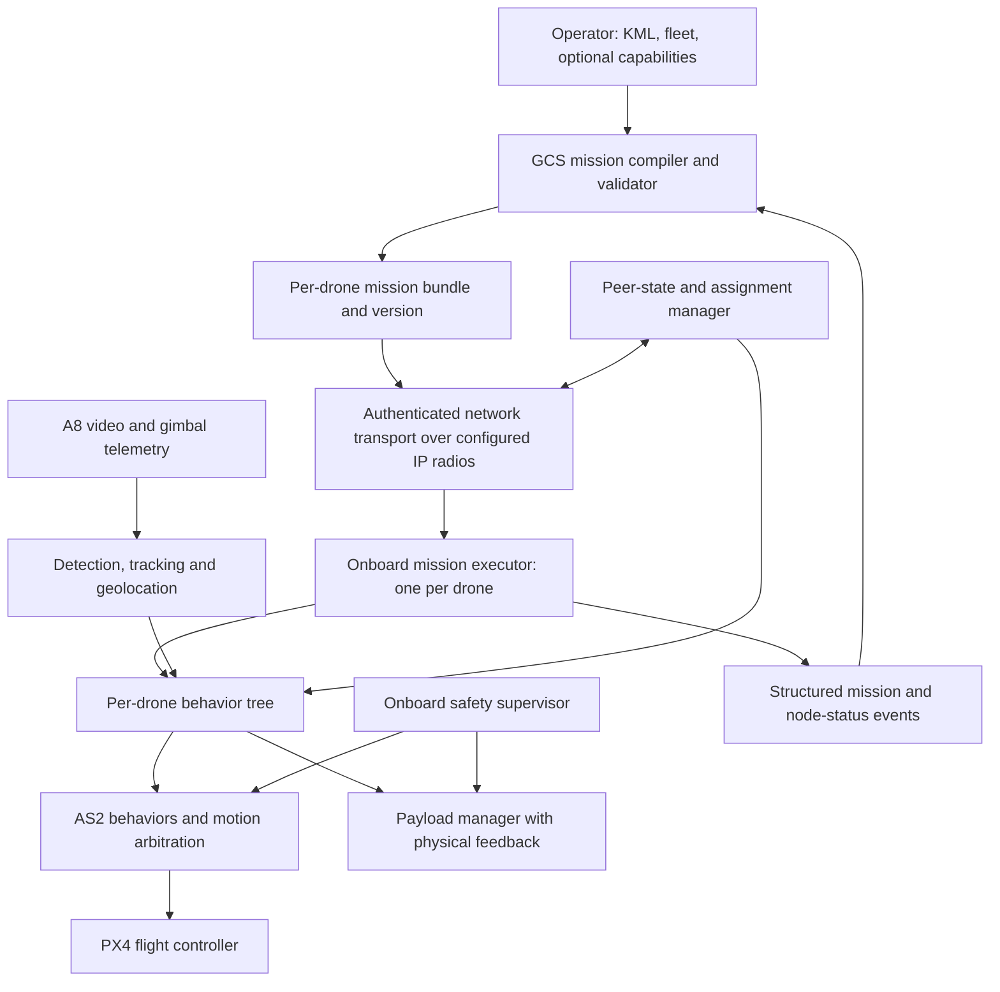
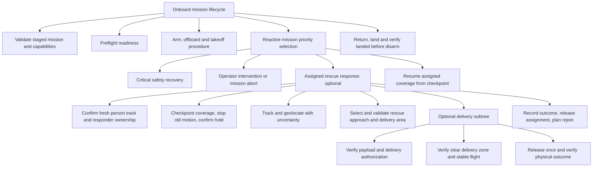

# AERIXIS swarm search-and-rescue extension

Design and source audit, 2026-10-15. Purpose confirmed by the operator: find people stranded by flooding and deliver food or medical kits. This document proposes implementation; it does not claim camera, swarm, or delivery functionality is operational. See [the complete BT inventory and graphs](BT_INVENTORY_AND_GRAPHS.md).

Implementation update: the runner/GCS foundation and an initial camera/perception overlay now exist. See [current phase status](IMPLEMENTATION_PHASES.md) and [validation](IMPLEMENTATION_VALIDATION.md). The audit findings below record the baseline before these changes; the long-term package layout remains a design.

## Baseline audit before implementation

The handoff describes the intended platform, but some assertions exceed the inspected implementation:

- The GCS builds survey XML and starts `ros2 launch` locally in `server.py:run_behavior_tree`. Writing `/tmp/as2_mission_tree.xml` is not a verified transfer to an onboard computer. Counting XML bytes in a traffic card does not prove network delivery.
- There is one shared mission file and one shared mission state. Per-drone namespacing alone does not isolate simultaneous missions.
- The GCS infers BT state from stdout keywords. Different nodes and repeated GoTo instances cannot be reliably identified this way.
- The BT executable returns 0 after its loop even on tree FAILURE. The GCS marks all steps successful on a zero subprocess exit. Fix both the runner's terminal result and explicit end-to-end result reporting; a ROS launch process's exit status is not the mission result.
- Stop sends MISSION_CLEAR_ALL, but the inspected stop path does not explicitly halt the separately launched BT process. Cancellation must be acknowledged by the actual onboard mission executor.
- The editor emits unregistered Wait nodes and incomplete FollowPath nodes. Node metadata must come from an authoritative registry with required ports.
- The perception package inspected here registers ArUco detection, not a human detector. Point-gimbal and gripper behavior packages exist, but the BT engine has no corresponding registered wrappers.
- The flocking implementation coordinates formation references. It does not establish a radio mesh or implement the complete autonomous coverage and delivery workflow. Its modifySwarmSrv membership branch also appears inverted: an absent drone is accessed using map.at(). Confirm with a focused test before using dynamic formation changes.

Do not label this system production-ready until mission execution, cancellation, isolation, and failure recovery are demonstrated.

## Architecture



Every drone runs its own AERIXIS stack, mission executor, safety supervisor, camera pipeline if equipped, and payload manager if equipped. The GCS plans, uploads, supervises and requests changes; onboard components enforce the mission envelope during link loss. Only one owner may command flight at a time. Route coverage, visual approach, formation following and recovery through one motion arbitration mechanism.

AERIXIS uses network connectivity; it does not create RF mesh connectivity. Configure the radio hardware and network separately, then measure peer reachability, packet age, latency, loss and routing behavior. A shared ROS_DOMAIN_ID does not establish routing, guarantee discovery or ensure common coordinates. Start with local ROS per drone and explicitly bridge the bounded telemetry/commands needed between drones. Select DDS discovery/QoS after testing the chosen radios.

## Proposed camera workspace

Use `/home/prince/aerostack2/rescue_ws` as an overlay, built after the existing AERIXIS workspace. Avoid recursively discovering the overlay twice from the parent workspace; add a COLCON_IGNORE at the overlay root and build it with explicit `--base-paths src` from inside the overlay. Verify discovery before building.

```text
rescue_ws/src/
  as2_siyi_camera/          RTSP image acquisition, CameraInfo and stream health
  as2_siyi_gimbal/          SDK protocol, measured attitude and command acknowledgement
  as2_rescue_interfaces/    Tracks, geolocation quality, payload and mission interfaces
  as2_person_perception/    Model adapter, stable tracks and freshness
  as2_rescue_behaviors/     Interruptible AS2 behaviors and resume checkpoints
  as2_rescue_bt/            Registered action, condition and decorator wrappers
  as2_payload_manager/      Payload sensors, release transaction and verification
  as2_swarm_coordinator/    Peer states, assignment ownership and recovery
  as2_mission_executor/     Validate, stage, start, pause, cancel and report
  as2_rescue_bringup/       Per-aircraft profiles and launches
```

These are proposed packages, not created or installed packages. Confirm the camera model/firmware, Ethernet connection, actual stream URI, gimbal control protocol, computer/OS, detector model and aircraft count before selecting drivers or inference dependencies.

For SIYI A8 mini, use its supported Ethernet video path and a separate gimbal control/telemetry adapter. Do not treat its USB-C port as a USB webcam. SIYI describes AI tracking through an optional tracking module; do not assume an unmodified camera exposes built-in person detection. An onboard detector and tracker can supply that function.

Proposed relative ROS topics, resolved inside each drone namespace:

| Topic | Purpose |
|---|---|
| camera/image_raw | Timestamped decoded image; bounded queues discard old frames |
| camera/camera_info | Calibrated intrinsics for the exact resolution and zoom |
| camera/health | Stream availability, frame age, decoder/reconnect status |
| gimbal/state | Measured attitude, rates, mode, stamp and feedback age |
| perception/detections | Person boxes, class and confidence |
| perception/tracks | Stable IDs, observation age and tracking quality |
| rescue/observations | Estimated location, covariance/quality and source track |
| payload/status | Present/absent/unknown, latch state and release transaction |
| mission/node_status | Mission ID, tree revision, node UID, state and reason |
| swarm/peer_state | Identity, reference frame, pose/velocity, uncertainty and age |

Detection runs continuously outside BT ticks. Conditions read cached, fresh state and return promptly. Long tasks return RUNNING and provide progress and cancellation. Do not decode video or run neural inference synchronously inside a condition.

Benchmark the chosen detector on representative aerial flood imagery and the real onboard computer. Measure end-to-end latency, missed people, false positives, thermal throttling and memory, not only model FPS. Model format, class mapping, preprocessing and licensing must be recorded in the aircraft profile.

## Mission compilation and swarm operation

1. Import KML and validate geometry, holes, exclusion areas, coordinate reference and altitude semantics. KML is an input boundary, not an executable mission.
2. Check fleet capabilities, energy reserve, payload availability and required sensors.
3. Partition coverage by endurance and capability, with separation and return corridors. Produce one assignment and tree per drone, plus a common mission manifest.
4. Validate node IDs, types, ports, limits, referenced files and compatible versions. Create immutable bundles with mission ID, drone ID, checksum and revision.
5. Stage each bundle onboard and require an acknowledgement of its exact checksum and validation result. Partial upload is never mission readiness.
6. Require the policy-defined readiness set: positioning, home/origin, battery, onboard stack, necessary peer/base links and payload sensors. Then issue an explicit start for that revision.
7. Share bounded peer states and coverage progress. Use timestamps, stale-state rejection, common geodetic reference or explicit transforms; never compare unrelated local origins.
8. Deduplicate person observations. Assign one responder using a time-bounded ownership lease, so multiple drones do not converge or deliver twice. During network partitions, restrict reassignment/delivery according to the agreed policy.
9. Persist completed coverage segments and delivery outcomes. Reassign unfinished work only after ownership is resolved. A disconnected drone is not automatically assumed stopped.

Fleet capabilities should be introduced in stages: independent partitioned coverage, peer awareness and separation, synchronized start, assignment changes, optional formation flight, responder selection, and fault recovery. Formation flight and distributed area search are different mission modes.

## Per-drone behavior structure

The following is a proposed logical graph. Labels are design names, not runnable registered XML nodes.



Keep the safety supervisor active through preflight, takeoff, mission, return and landing. A safety branch that succeeds must not accidentally allow coverage to restart. Latch abort/recovery state until a deliberate transition clears it. A mission-start sequence must not be reticked in a way that rearms or retakes off during an interruption.

Use ReactiveFallback for priority selection, guarded reactive sequences for continuously checked actions, and ordinary sequences for ordered work. Do not run two motion actions in Parallel. A Timeout or halt is not proof the vehicle stopped: confirm cancellation acknowledgement and a stable holding state before handing control to another behavior. The current action wrapper's halt waits for the cancellation service result; audit actual motion termination and late result races.

Save coverage segment ID, progress, completed segments, mission revision and last safe resume point explicitly. SequenceWithMemory is not a persistent mission checkpoint and does not guarantee correct resumption after process restart or subtree halt. Replan a safe rejoin route rather than restarting the entire mission.

For each new feature: define ROS inputs/actions and failure semantics; implement the behavior independently; implement and register its BT wrapper; publish its typed ports/capabilities to the GCS; add it to a template; test its interruption and failure paths. Adding a box in the editor or TreeNodesModel alone does not implement functionality.

## Person observation and delivery

Detection identifies a possible person. Tracking maintains an observation identity. Gimbal control centers the observation. Geolocation estimates its world location. Flight guidance plans a valid approach. Payload management performs a separately authorized delivery. Keep these contracts distinct.

Gimbal yaw/pitch alone does not determine the person's location. Use calibrated image geometry, mounting transforms, measured gimbal orientation, synchronized aircraft attitude/position and range or a suitable surface model. Account for zoom, latency, coordinate conventions and uncertainty. A nadir-looking camera does not prove the aircraft is centered above the person; verify the observation's image position and world-relative geometry. In flooding, water, roofs and boats invalidate an unverified flat-ground assumption.

For food/medical aid, select a suitable delivery zone near the recipient and keep people clear of the package impact area. First implement observation, geotagging and operator review; enable approach and delivery only after their sensing and recovery behavior are validated. Use test dummies and inert payloads during validation.

Payload state must come from suitable physical feedback such as presence/load/latch sensors. A UI checkbox or servo command is not proof of loading or delivery. Include PRESENT, ABSENT, UNKNOWN, RELEASE_REQUESTED, RELEASE_CONFIRMED and RELEASE_UNCERTAIN states. Store a unique durable release transaction ID. Never automatically repeat a release after timeout, restart or ambiguous acknowledgement; reconcile physical state first.

Optional template settings: survey only; survey plus person observations; survey plus approved rescue deliveries; planned waypoint delivery. Turning a feature off removes its mission subtree and optional dependencies, but cannot remove fundamental flight safety checks. Payload delivery requires payload capability; detection-only missions do not.

## Failure policies

| Event | Required behavior |
|---|---|
| Camera/track stale or target lost | Stop approach, inhibit release, bounded reacquisition or report-and-resume policy |
| Uncertain geolocation or unsafe delivery zone | Keep observation for review; no autonomous delivery based on uncertain geometry |
| Peer state stale or separation conflict | Inhibit conflicting motion; hold/replan under local safety authority |
| GCS/mesh loss | Apply mission-specific onboard timeout policy; do not invent peer locations or blindly continue delivery |
| Battery reserve reached | End coverage and execute a feasible return/landing policy |
| Position/estimator failure | Use the flight controller's appropriate tested failsafe; RTL may be unavailable |
| Payload missing/jammed/uncertain release | Inhibit further release, report reason, reconcile or finish without delivery |
| BT/behavior crash | Watchdog and flight-controller fallback; retain durable progress and release state |
| Cancel not acknowledged | Keep exclusive motion ownership, escalate recovery; do not launch a competing action |

No single fallback eliminates every risk. Set limits from aircraft testing, stopping distance, localization error, environment and communications performance; do not inherit the handoff's 5 m or long-range claims as universal guarantees.

## GCS and deployment

Store one typed mission graph as the source for XML, the 2D/3D views and validation. Give every instance a stable UID, especially repeated GoTo nodes. Present each drone's staged/executing revision, node state (IDLE/RUNNING/SUCCESS/FAILURE/SKIPPED where supported), last update, pending cancellation, recovery reason, battery, peer state, detection and payload state. On disconnect show stale/unknown data, not an animated guessed status.

Beginner workflow: connect aircraft, run guided equipment checks, import KML, choose capabilities, inspect assignments and delivery points, simulate/validate, upload, verify onboard readiness, start and monitor. Advanced editing may change mission subtrees but cannot bypass mandatory safety policy. Upload does not start a mission. Handle live edits as validated revisions activated at defined safe transitions.

Use supported hardware/OS profiles with pinned dependencies, per-aircraft identity/calibration, service supervision, logs, authenticated commands, rollback and separation of flight-critical control from heavy inference. A Raspberry Pi 5 image is one supported target; arbitrary onboard computers need their own tested profiles. The companion computer image is separate from PX4 firmware on the flight controller.

## Implementation order and acceptance

1. **Execution correctness:** fix truthful terminal results, structured status, cancel/hold acknowledgement, input validation and independent per-drone state. Demonstrate a failing tree stays failed and a canceled action cannot keep commanding motion.
2. **Camera bench integration:** build the overlay camera/gimbal nodes. Validate real timestamps, calibration, stream recovery, stale-frame rejection and measured gimbal telemetry with motors inactive.
3. **Detection and observation:** integrate the provided model, stable tracks and geotag quality. Test prerecorded aerial footage, identity changes, occlusion and missing measurements.
4. **Single-drone SITL interruption:** pause coverage, confirm hold, run simulated observation, then safely resume the saved segment. Inject action failure, target loss and process restart.
5. **Payload subsystem:** test sensors and durable transaction handling on a bench. Demonstrate no duplicate actuation after timeout or restart; use inert delivery tests before operational kits.
6. **Three-drone SITL:** independent uploads, shared coordinates, partitioned routes, single responder ownership, separation and coverage reassignment. Inject packet delay/loss, partition and drone failure.
7. **GCS product workflow:** capability-driven templates, actual onboard node telemetry, simulation preview, per-drone acknowledgements and operator-readable recovery reasons.
8. **Deployment validation:** supported computer images, resource budgets, repeatable startup/recovery and staged field trials. Production readiness follows measured acceptance evidence.

## Primary references

- [SIYI A8 mini product and tracking options](https://www.siyi.biz/en/product/tri-axis-single-camera-gimbal/a8-mini/)
- [SIYI A8 mini FAQ, including USB-C limitations](https://www.siyi.biz/en/product/tri-axis-single-camera-gimbal/a8-mini/faq/)
- [BehaviorTree.CPP node semantics](https://behaviortree.dev/docs/learn-the-basics/BT_basics/)
- [Aerostack2 multi-drone Gazebo example](https://aerostack2.github.io/_02_examples/gazebo/project_gazebo/index.html)

Hardware questions still open: exact A8 firmware/connection, onboard computer and OS, trained model path/format, drone count, mesh radios, payload actuator and feedback sensors, and available altitude/range measurements.
